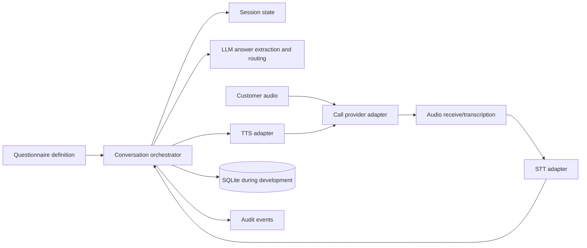

# teleMER Calling Service Plan

## 1. Goal

Build a phone conversation service that calls an insurance customer, asks a conditional set of questions, understands spoken answers, chooses the next question, and stores the collected information.

The first version must be runnable locally with free and open-source software. Real outbound phone calls are a later integration because PSTN access, phone numbers, and minutes are normally not free.

## 2. Product Boundaries

### In scope

- Questionnaires defined as structured data.
- Text-to-speech (TTS) for questions and prompts.
- Speech-to-text (STT) for customer answers.
- Conditional question routing.
- LLM-assisted answer extraction and next-question selection.
- Conversation state and resumable call sessions.
- A provider adapter for starting and ending calls.
- Structured logs and an audit trail.
- Write backend process and call-pipeline logs to stdout without customer transcript contents.

### Out of scope for the first version

- Making insurance coverage, eligibility, pricing, or claims decisions.
- Replacing a licensed insurance representative.
- Recording or processing production customer data.
- Automatic enrollment or other irreversible actions.
- Production PSTN deployment before privacy, consent, retention, and security review.

## 3. Recommended Free-First Stack

| Capability | First choice | Purpose |
|---|---|---|
| API/orchestration | Python + FastAPI | HTTP API and call-session control |
| Data model | Pydantic | Validate questionnaires, answers, and events |
| Local persistence | SQLite | Development sessions and collected answers |
| STT | Whisper via `faster-whisper` or `whisper.cpp` | Convert customer audio to text locally |
| TTS | Piper | Generate natural-sounding question audio locally |
| LLM | Ollama with a small instruct model | Extract answers and propose the next step locally |
| Background work | Start with asyncio; add a queue only when needed | Keep audio and LLM work out of request handlers |
| Testing caller | Browser/WebSocket simulator or recorded audio fixtures | Test without PSTN charges |
| Call provider | Provider interface plus mock adapter first | Delay provider lock-in and cost |

The exact model should be selected after a small quality and latency benchmark on the development machine. The LLM must return validated JSON, never free-form control instructions.

## 4. High-Level Architecture



The orchestrator owns the conversation state. STT, TTS, LLM, and calling providers are replaceable adapters. No provider should decide which business question comes next.

## 5. Conversation Model

A questionnaire should be data, not hard-coded branching logic. A minimal question definition should contain:

```json
{
  "id": "policy_start_date",
  "text": "When did your current policy start?",
  "answer_type": "date",
  "required": true,
  "next": "vehicle_count",
  "retry_policy": {"max_attempts": 2}
}
```

Conditional routing should be explicit and inspectable:

```json
{
  "id": "has_prior_claim",
  "answer_type": "boolean",
  "choices": {
    "yes": "prior_claim_details",
    "no": "driver_details"
  }
}
```

The LLM may normalize language and extract a candidate answer, but deterministic validation and routing must remain in application code. If confidence is low or the answer is invalid, ask a clarification question or transfer to a human rather than guessing.

## 6. Call Lifecycle

1. Create a call session with a questionnaire version and customer reference.
2. Obtain consent where required and identify teleMER clearly.
3. Load the first question.
4. Generate question audio with TTS.
5. Play the prompt through the call provider or local simulator.
6. Receive customer audio.
7. Detect the end of the response and transcribe it with STT.
8. Send only the current question, answer text, allowed answer schema, and relevant state to the LLM.
9. Validate the LLM's structured result with Pydantic.
10. Save the transcript, extracted value, confidence, and audit event.
11. Deterministically choose the next question, retry, clarify, transfer, or finish.
12. End the call and persist the final session status.

## 7. Build Phases

### Phase 0: Project foundation

- Create the Python application structure.
- Add configuration through environment variables.
- Add Pydantic models for questionnaires, sessions, answers, and events.
- Add SQLite repositories.
- Add a health endpoint and basic logging.

**Exit criterion:** A session can be created and its state can be saved and loaded.

### Phase 1: Deterministic questionnaire engine

- Implement question ordering and conditional transitions without an LLM.
- Support required fields, answer types, retries, clarification, and completion.
- Add unit tests for every branch and invalid-answer path.

**Exit criterion:** A complete questionnaire can run from scripted answers with predictable results.

### Phase 2: Local TTS and STT

- Add Piper behind a TTS interface.
- Add faster-whisper or whisper.cpp behind an STT interface.
- Support WAV fixtures and generated question audio.
- Measure transcription quality and response latency.

**Exit criterion:** A local audio fixture can be transcribed and every question can produce playable audio.

### Phase 3: LLM extraction and routing assistance

- Run the LLM locally through Ollama.
- Define a strict JSON response schema, for example: extracted value, normalized value, confidence, clarification needed, and reason code.
- Validate output and reject malformed or unsupported values.
- Keep routing rules in the questionnaire engine.
- Add tests for ambiguous, incomplete, contradictory, and off-topic answers.

**Exit criterion:** The LLM improves normalization and clarification without being able to bypass validation or routing rules.

### Phase 4: Local call simulator

- Build a browser or WebSocket simulator that plays TTS audio and accepts microphone or fixture audio.
- Use a push-to-talk browser speech-recognition flow with interim text and send the final transcript to the backend; browser recognition may use an online service and requires browser support.
- Add interruption, silence timeout, retry, and hang-up behavior.
- Add a session timeline for debugging.

**Exit criterion:** An end-to-end call can be completed locally without a phone provider.

### Phase 5: Calling provider adapter

- Define a provider-neutral interface: create call, play audio, receive audio/events, hang up, and transfer.
- Implement a mock provider first.
- Select a real provider only after checking country coverage, pricing, recording behavior, webhooks, and data-processing terms.
- Keep provider credentials and phone numbers out of source control.

**Exit criterion:** The same orchestrator runs against the mock provider and one real provider in a controlled test environment.

### Phase 6: Security and pilot readiness

- Add authentication and authorization to management APIs.
- Encrypt sensitive data at rest and in transit.
- Minimize stored transcripts and configure retention/deletion.
- Add consent, opt-out, do-not-call, human-transfer, and failure handling.
- Add monitoring for call failures, latency, transcription confidence, and LLM validation failures.
- Complete legal, compliance, and privacy review before production customer calls.

**Exit criterion:** A small, consented pilot can be operated with an incident and rollback procedure.

## 8. Initial API Shape

These endpoints are sufficient for the first local slices:

- `POST /questionnaires` - create or validate a questionnaire.
- `GET /questionnaires/{id}` - retrieve a versioned questionnaire.
- `POST /sessions` - create a conversation session.
- `GET /sessions/{id}` - inspect state and collected answers.
- `POST /sessions/{id}/answers` - submit a text answer in simulator mode.
- `POST /sessions/{id}/complete` - end a simulated session.
- `POST /calls` - request a call through the configured provider adapter.
- `POST /webhooks/calls/{provider}` - receive provider events.

## 9. Data and Privacy Rules

- Use synthetic data during development.
- Store a customer reference rather than unnecessary identifying information.
- Version every questionnaire and preserve the version used for each session.
- Treat transcripts, audio, extracted answers, and logs as sensitive.
- Do not send more context to the LLM than the current task requires.
- Never place secrets, phone numbers, raw audio, or customer data in logs.
- Add an explicit human escalation path for uncertainty, distress, complaints, or requests outside the script.

## 10. Quality Gates

Before moving between phases, verify:

- Unit tests cover normal, conditional, invalid, silent, and interrupted responses.
- The system never advances on an unvalidated answer.
- Malformed LLM output causes a retry or human escalation, not a silent fallback.
- A failed STT, TTS, LLM, or provider call has a bounded retry policy.
- Every state transition is auditable.
- The call can be safely stopped and resumed.
- Test data is synthetic and disposable.

## 11. First Implementation Slice

Start with Phase 0 and the smallest part of Phase 1:

1. Define the questionnaire, question, answer, and session models.
2. Create one sample insurance intake questionnaire with two conditional branches.
3. Implement session creation and deterministic `submit_answer` behavior.
4. Add tests for both branches and invalid answers.
5. Add a text-only CLI or API flow before integrating audio.

This gives us a stable conversation engine to which STT, TTS, the local LLM, and the calling provider can be added one at a time.
